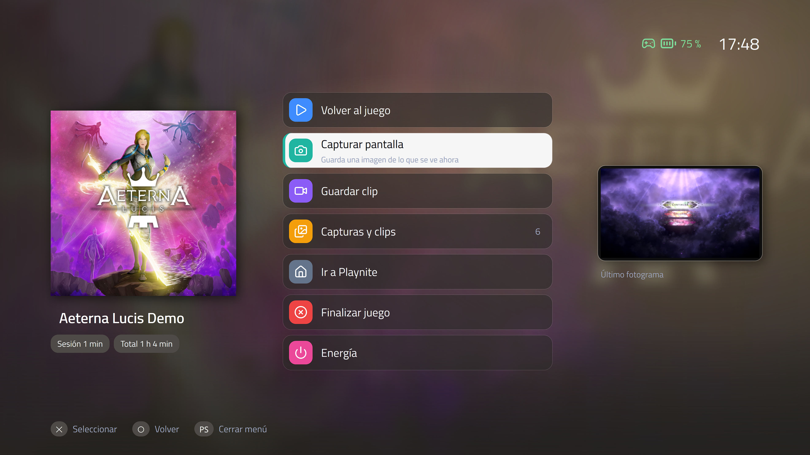
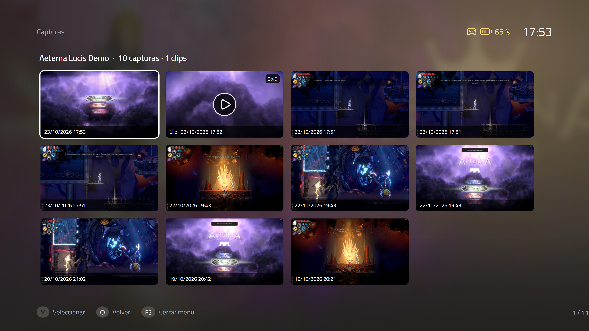
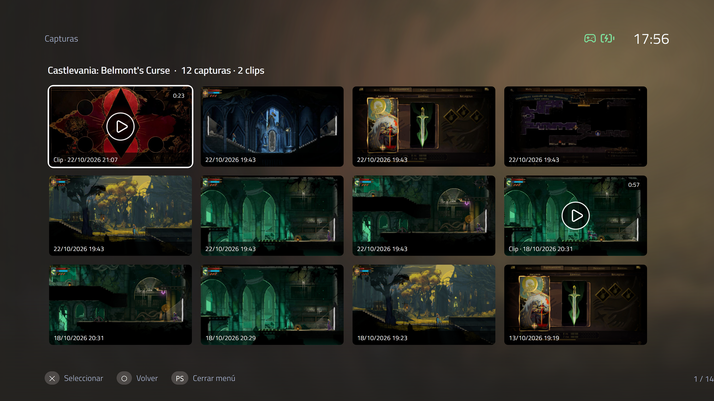
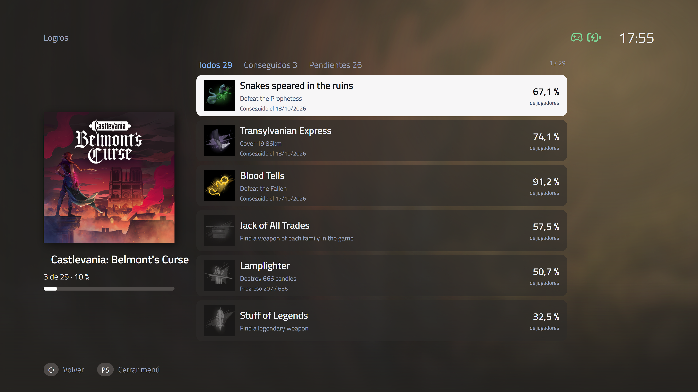
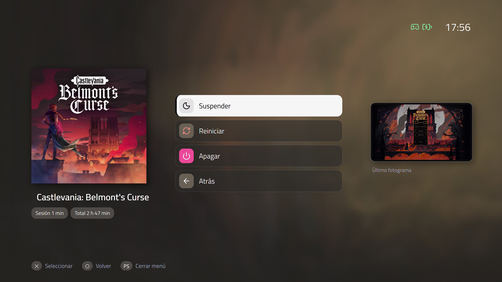

# Console Overlay for Playnite

A console-style overlay menu for [Playnite](https://playnite.link). Press the controller's Guide/PS button (or a keyboard shortcut) while you play: the game is paused, a menu appears over it, and you can go back to the game, take a screenshot, check your achievements, leave to Playnite, close the game or power off the PC — all from the couch, with a controller.

> Español: [README.es.md](README.es.md)







https://github.com/user-attachments/assets/9ddb563b-5aff-49cf-886e-8047f501044a

## Features

- **Opens in-game only**, like a console. It does nothing on Playnite's home screen (unless you enable the power menu there).
- **Pauses the game** while the menu is open and mutes only the game's audio. Games with anti-cheat (EasyAntiCheat, BattlEye, Vanguard...) are **not** paused, so you never lose an online match.
- **Menu**: back to the game · screenshot · save clip · captures and clips gallery · achievements · go to Playnite (the game stays paused) · end game · power menu (suspend / restart / shut down).
- **Looks native**: cover art from your library, live preview (last frame if the game is paused), session timer, clock, and controller battery for several controllers at once (DualSense, DualShock, Xbox, Switch Pro, 8BitDo and other SDL controllers).
- **Follows your Playnite theme**: colors and font are read from the theme you use (or from the game's cover art), and the button icons follow the controller type configured in Playnite's fullscreen settings.
- **Works with games run as administrator**: opens the menu without pausing and can remove the "run as administrator" flag if you ask it to.
- **Capture programs**: it presses the keyboard shortcut of your capture tool (GameHQ, NVIDIA App, Steam, Xbox Game Bar...) and finds the files in the usual folders.
- **Smooth**: no continuous animations; effects only run on the selected row and during transitions.
- **9 languages**: English, Spanish, French, German, Portuguese, Italian, Russian, Chinese, Japanese (Playnite's language by default, then Windows').

## Requirements

- Windows 10 or 11 · Playnite 10. Developed and tested in Fullscreen mode; Desktop mode is untested.
- A controller or a keyboard shortcut. The Guide/PS button needs the controller to be visible to Playnite (SDL).

## Install

1. Download `ConsoleOverlay_x_y_z.pext` from the [Releases](https://github.com/galcn10/ConsoleOverlay/releases) page.
2. Double-click it (or drag it onto Playnite). Playnite asks to install and restart.
3. Open **Add-ons → Extensions settings → Console Overlay**.

## Optional: in-menu clip player (mpv)

Clips can play inside the overlay using [mpv](https://mpv.io), a free video player. It is **not included** in the plugin. To enable it, download an mpv build for Windows, and copy `mpv.exe` (with its DLLs, if any) into a folder named `mpv` inside the plugin folder (`%AppData%\Playnite\Extensions\ConsoleOverlay_galcn10\mpv\`). Without it, selecting a clip opens it in the Windows player instead. mpv is GPL licensed and runs as a separate program; see [THIRD-PARTY-NOTICES.txt](THIRD-PARTY-NOTICES.txt).

## Quick start

- **Controller**: press the **Guide/PS button** (on by default) to open the menu or return to the game. Long press: power menu. If Steam or another program already uses that button, disable its action there, or turn on the alternative in *Open the menu*: hold **Select + Start** for 1 s (off by default). A notification explains this the first time.
- **Keyboard / JoyToKey / Steam Input**: default shortcuts are `Ctrl+Alt+F10` (menu) and `Ctrl+Alt+F11` (end game). Map them to any button.
- **Capture program**: pick yours in *Captures and clips* so the menu can trigger it.

## What the plugin does on your system

Because it controls other programs, here is exactly what it does:

| Action | How | Why |
|---|---|---|
| Pause / resume the game | `NtSuspendProcess` / `NtResumeProcess` on the game's processes | Freeze the game while the menu is open |
| Mute the game | Windows Core Audio sessions of the game's processes | Silence only the game, not the system |
| Read the controller | Playnite's own `SDL2.dll` and read-only HID access for the battery | Guide button and battery level |
| Send keystrokes | `keybd_event` for the shortcuts **you** configure | Trigger your capture program |
| Register hotkeys | `RegisterHotKey` (default `Ctrl+Alt+F10/F11`) | Open the menu / end the game |
| Move windows | Win32 `SetWindowPos`, `SetForegroundWindow`, DWM thumbnails | Show the menu, bring the game back, preview |
| End the game | Normal close, then force. For elevated games it asks Windows for administrator permission (UAC) | "End game" |
| Power commands | `cmd /c <command>` with the commands in settings (default `shutdown /r /t 0`, `shutdown /s /t 0`), and the standard suspend call | Restart, shut down, suspend |
| Remove "run as administrator" | Edits the *current user's* compatibility flag in `HKCU\...\AppCompatFlags\Layers` for that game's exe, only if you accept or enable the option | Let the game be paused |
| Read achievements | Read-only access to the database of the *Playnite Achievements* plugin | Show achievements in the menu |
| Playnite setting | While a game runs, "Guide button focuses Playnite" is limited to "only when no game is running", and restored when the game stops | Playnite would otherwise pop up when you press the button |

It does **not** use the network, collect data, or modify game files. Everything it stores lives in the plugin's data folder.

## Known limitations

- Games in true exclusive fullscreen may show a black preview.
- Some games minimize themselves when they lose focus; the plugin brings them back, but behavior varies.
- A normal (non-elevated) Playnite cannot pause or close an elevated game: use the plugin's options, run Playnite as administrator, or remove the flag.
- Anti-cheat games are never paused by default (setting *Don't pause anti-cheat games*).

## Build from source

Requires the .NET SDK. From this folder:

```
dotnet build -c Release
```

The output (`bin\Release\`) contains `ConsoleOverlay.dll`, `extension.yaml`, `icon.png`, `LICENSE` and `THIRD-PARTY-NOTICES.txt`. Pack it with Playnite's Toolbox: `Toolbox.exe pack "bin\Release" "out"`.

## License and credits

MIT License — Copyright (c) 2026 galcn10. See [LICENSE](LICENSE).

Third-party components and notices are in [THIRD-PARTY-NOTICES.txt](THIRD-PARTY-NOTICES.txt): [Lucide](https://lucide.dev) / Feather icons and [PlayniteNextOverlay](https://github.com/AleksejSg/PlayniteNextOverlay) (the read-only queries for the Playnite Achievements database).

## Trademarks

"PlayStation" and "DualSense" are trademarks of Sony Interactive Entertainment; "Xbox" is a trademark of Microsoft; "Steam" is a trademark of Valve; "Nintendo" and "Switch" are trademarks of Nintendo; GameHQ, NVIDIA and the other names are trademarks of their owners. They are mentioned only to say which hardware and programs are compatible. This project is not affiliated with, endorsed by or sponsored by any of them. It does not use their logos or artwork.
